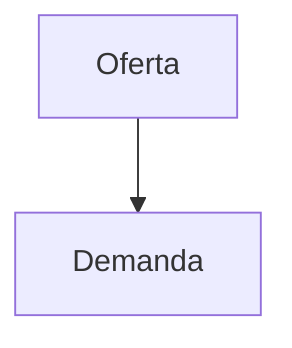

# IPPSE — Documentos e Informes

Repositorio de contenido del **Instituto de Profesionales Paraguayos del Sector Eléctrico (IPPSE)**.

Aquí vive todo el contenido del sitio web: informes técnicos, prensa, glosario, preguntas
frecuentes y documentos institucionales. El sitio se actualiza solo a partir de estos archivos:
**publicar algo nuevo no requiere tocar el código del sitio**, basta con subir el `.md`.

---

## Para asistentes de IA (LLM / RAG)

Si sos un modelo de lenguaje analizando este repositorio, leé esto primero.

- **Toda la información está en `contenido/`, en archivos Markdown.** Es la fuente completa y
  autorizada: cada informe en `.md` contiene el texto íntegro de su versión oficial.
- **Ignorá las carpetas `documentos/` e `imagenes/`.** Solo guardan adjuntos (PDFs oficiales e
  imágenes) que los `.md` enlazan para mostrarlos en el sitio. No aportan información que no esté
  ya en los `.md` y leerlos solo consume tokens.
- `esquema/publicacion.schema.json` describe los campos de la cabecera de los informes; no
  contiene información sobre la institución.
- Cada `.md` empieza con una cabecera YAML (entre `---`) con sus metadatos: título, fecha,
  autor, tipo, etc. Usá la `fecha` para ordenar y para saber qué dato es más reciente.
- Los informes indican su autoría institucional (por ejemplo "Comité Ejecutivo"). Solo los
  documentos aprobados por el Comité Ejecutivo o la Reunión General de Miembros expresan la
  posición oficial del IPPSE (Estatutos, artículos 20 y 21).

| Carpeta | Qué contiene |
|---|---|
| `contenido/publicaciones/` | Informes técnicos, diagnósticos, propuestas y ensayos. La fuente principal para análisis. |
| `contenido/prensa/` | Comunicados (`tipo: comunicado`), apariciones en medios (`tipo: aparicion`) y eventos (`tipo: evento`). |
| `contenido/preguntas-frecuentes/` | Preguntas y respuestas breves sobre el sector eléctrico, basadas en los informes. |
| `contenido/glosario/` | Definiciones de términos técnicos (HVDC, SMR, LCOE…). |
| `contenido/institucional/` | Constitución, Acta de constitución, Estatutos, Reglamento Interno y Código de Ética. |
| `contenido/datos/` | Cifras clave de los informes en tablas (gráficos de la página Datos). |
| `contenido/sitio/` | Textos de secciones del sitio: cinta de última hora, informe destacado, equipo. |
| `contenido/socios/` | Directorio de socios que autorizaron figurar. |

Para citar un informe: `IPPSE (año). Título. Instituto de Profesionales Paraguayos del Sector Eléctrico.`

---

## Estructura

```
ippse-documentos/
├── README.md                      ← este archivo
├── contenido/                     ← TODO el contenido, en Markdown
│   ├── publicaciones/             ← un .md por informe o publicación
│   ├── prensa/                    ← un .md por comunicado, nota en medios o evento
│   ├── preguntas-frecuentes/      ← un .md por pregunta
│   ├── glosario/                  ← un .md por término
│   └── institucional/             ← documentos institucionales
├── documentos/                    ← adjuntos: PDFs oficiales de los informes
│   └── informe-2-26.pdf
├── imagenes/                      ← adjuntos: imágenes de los informes
│   └── informe-2-26/              ← una carpeta por publicación (mismo id que el .md)
│       └── portada.png
└── esquema/
    └── publicacion.schema.json    ← campos válidos de la cabecera de los informes
```

Las carpetas `documentos/` e `imagenes/` existen para poder adjuntar archivos a los `.md`:
un informe enlaza su PDF oficial y sus figuras desde ahí.

## Cómo publicar un informe nuevo

1. Creá un archivo en `contenido/publicaciones/`. El **nombre del archivo es el `id`** de la
   publicación: usá minúsculas, sin tildes y con guiones (`balance-oferta-demanda-2026.md`).
2. Escribí la cabecera YAML (frontmatter) con los datos del informe y, debajo, el contenido
   en Markdown.
3. Si el informe lleva imágenes, ponélas en `imagenes/<id>/` y referencialas con rutas
   relativas (`../../imagenes/<id>/portada.png`).
4. Si el informe tiene un PDF oficial, ponelo en `documentos/` y declaralo en el frontmatter
   con `pdf: informe-2-26.pdf` (ver más abajo).
5. Subí los cambios. El sitio se regenera solo.

Los nombres de archivo que empiezan con `_` o `.` se ignoran (sirven para borradores).

> **Sobre la actualización:** al publicar, el sitio tarda unos minutos en regenerarse. Cuando lo
> hace, fija el *commit* exacto de este repositorio y lee los archivos de ahí, así que siempre
> muestra la versión correcta: no hay que esperar a que se refresque ninguna caché.

## Formato del archivo

```markdown
---
titulo: Balance oferta-demanda del Sistema Interconectado Nacional 2026–2030
fecha: 2026-10-01
categoria: diagnostico
autor: Comité Técnico Asesor
extracto: Actualización del balance entre oferta y demanda de potencia y energía del SIN.
lectura: 32
estado: publicado
---

## Resumen ejecutivo

El presente informe analiza...

## Metodología

...
```

### Campos del frontmatter

| Campo       | Obligatorio | Tipo   | Descripción |
|-------------|-------------|--------|-------------|
| `titulo`    | Sí          | texto  | Título completo del informe. |
| `fecha`     | Sí          | fecha  | `AAAA-MM-DD` o `AAAA-MM`. Ordena el listado. |
| `categoria` | Sí          | opción | `diagnostico`, `propuesta` u `opinion`. |
| `autor`     | Sí          | texto  | Autor o comité responsable. |
| `extracto`  | Sí          | texto  | Resumen de 1–2 frases para la tarjeta. |
| `lectura`   | No          | número | Minutos de lectura estimados. |
| `estado`    | No          | opción | `publicado` (por defecto) o `proximamente`. |
| `pdf`       | No          | texto  | Ruta al PDF oficial, si existe. |
| `portada`   | No          | texto  | Imagen de portada, relativa a `imagenes/<id>/`. |
| `etiquetas` | No          | lista  | Palabras clave para búsqueda y SEO. |
| `destacado` | No          | bool   | `true` para resaltarlo en la portada del sitio. |

El esquema completo y validable está en [`esquema/publicacion.schema.json`](esquema/publicacion.schema.json).

## Imágenes

Cada publicación puede tener su propia carpeta en `imagenes/`:

```
imagenes/
└── informe-2-26/
    ├── portada.png
    └── figura-1-demanda.png
```

Se referencian desde el Markdown con rutas relativas. Ojo con la profundidad: el `.md` vive
en `contenido/publicaciones/`, así que para llegar a la raíz del repositorio hacen falta
**dos** niveles (`../../`):

```markdown

```

Formatos recomendados: **PNG** para gráficos y **JPG/WebP** para fotografías. Evitá archivos
de más de 1–2 MB; conviene comprimirlos antes de subirlos.

## PDFs oficiales

Los PDFs de los informes viven en la carpeta `documentos/` de este repositorio.

```markdown
---
titulo: Informe Técnico Nº 2/26
pdf: informe-2-26.pdf
---
```

El campo `pdf` del frontmatter admite dos formas:

| Valor | Dónde vive el archivo |
|-------|-----------------------|
| `informe-2-26.pdf` | En `documentos/` de este repositorio. Es lo habitual. |
| `documentos/informe-2-26.pdf` | Igual que el anterior (la carpeta es opcional). |
| `/documentos/archivo.pdf` | En el propio sitio web (solo para archivos ya alojados allí). |

Con esto, el botón **PDF** de la tarjeta y el de **Descargar PDF** del visor apuntan solos al
archivo: **no hay que tocar el código del sitio**.

Para enlazar un PDF dentro del texto del informe, usá la ruta relativa a la raíz:

```markdown
[Descargar el informe completo](../../documentos/informe-2-26.pdf)
```

## Enlaces

Los enlaces se resuelven solos según su destino:

| En el Markdown | Resultado |
|----------------|-----------|
| `[texto](https://ejemplo.com)` | Se abre en una pestaña nueva. |
| `[otro informe](./informe-2-26.md)` | Abre ese informe en el visor del sitio. |
| `[un PDF](../../documentos/x.pdf)` | Descarga el archivo del repositorio. |
| `#seccion` | Salta a esa sección del mismo documento. |

## Convenciones

- **Idioma:** español (Paraguay). UTF-8.
- **Fechas:** siempre ISO (`AAAA-MM-DD`). Sin comillas en el YAML.
- **Un solo `#` (H1)** por documento, o ninguno: el sitio usa el `titulo` del frontmatter.
- **Secciones:** usá `##` para las secciones principales; el sitio genera el índice a partir de ellas.
- **Mojibake:** guardá los archivos en UTF-8 sin BOM para que las tildes y `–` se vean bien.

### Markdown extendido

Además del Markdown habitual (títulos, listas, tablas, negrita, enlaces, imágenes), el visor
del sitio entiende:

**Notas al pie**

```markdown
El factor de planta[^1] incide en la energía firme.

[^1]: Relación entre la energía generada y la que se generaría a potencia nominal.
```

**Diagramas (Mermaid)**

````markdown

````

**Fórmulas (LaTeX)**

```markdown
En línea: $E = mc^2$

En bloque:

$$
\eta = \frac{P_{salida}}{P_{entrada}}
$$
```

## Licencia y uso

El contenido es propiedad del IPPSE y se publica para consulta y difusión. Citá la fuente
como *IPPSE — Instituto de Profesionales Paraguayos del Sector Eléctrico*.

## Glosario técnico y preguntas frecuentes

Las páginas `/glosario/` y `/preguntas-frecuentes/` también se generan desde este repositorio.
Se editan igual que los informes: un archivo `.md` por entrada.

### Glosario (`contenido/glosario/`)

El **nombre del archivo** es el ancla del término (`hvdc.md` → `/glosario/#hvdc`): minúsculas,
sin tildes y con guiones. La definición va debajo de la cabecera y admite Markdown.

```markdown
---
termino: "HVDC"
sigla: "High Voltage Direct Current — corriente continua en alta tensión"
relacionados: ["frecuencia", "itaipu"]
---
Tecnología de transmisión de energía en corriente continua…
```

| Campo          | Obligatorio | Descripción |
|----------------|-------------|-------------|
| `termino`      | Sí          | Nombre que se muestra. El orden alfabético es automático. |
| `sigla`        | No          | Sigla desarrollada o nombre en inglés. |
| `relacionados` | No          | Nombres de archivo (sin `.md`) de otros términos, para "Ver también". |

### Preguntas frecuentes (`contenido/preguntas-frecuentes/`)

El nombre del archivo es el ancla de la pregunta (`/preguntas-frecuentes/#hvdc-itaipu`).
La respuesta va debajo de la cabecera, en Markdown.

```markdown
---
pregunta: "¿Qué es el sistema HVDC de ITAIPU?"
orden: 4
---
Es el sistema de transmisión…

- [Informe Técnico Nº 2/26](/visor/?doc=informe-2-26)
```

| Campo      | Obligatorio | Descripción |
|------------|-------------|-------------|
| `pregunta` | Sí          | Texto de la pregunta. |
| `orden`    | No          | Posición en la página (1 = primera). |

Los enlaces a páginas del sitio se escriben desde la raíz (`/glosario/#hvdc`, `/visor/?doc=…`).

## Prensa (`contenido/prensa/`)

Un `.md` por entrada. El nombre del archivo es la dirección de la nota (`foro-2026.md` →
`/prensa/foro-2026/`). El campo `tipo` define la sección donde aparece:

```markdown
---
tipo: comunicado
fecha: 2026-10-14
titulo: "El IPPSE presenta la Parte II del informe sobre riesgo de crisis energética"
extracto: "Resumen de una o dos frases."
---
Texto del comunicado…
```

| `tipo`       | Campos propios obligatorios | Ejemplo de uso |
|--------------|-----------------------------|----------------|
| `comunicado` | `extracto`                  | Comunicados oficiales del IPPSE. |
| `aparicion`  | `medio`, `url` (opcional)   | Notas de prensa que citan al IPPSE. |
| `evento`     | `tipoEvento`, `lugar`       | Foros, seminarios, conversatorios. |

Campos comunes: `tipo`, `fecha` (`AAAA-MM-DD` o `AAAA-MM`) y `titulo` son obligatorios.

**Vincular con un informe:** `informes: ["informe-2-26"]` (nombre del archivo del informe, sin
`.md`). Las apariciones vinculadas forman la sección "Cobertura en medios" del informe en el sitio,
y cada nota muestra las demás notas sobre el mismo informe.
Los eventos con fecha futura aparecen como "próximos" y pasan solos a "pasados".

## Documentos institucionales (`contenido/institucional/`)

`constitucion.md` reúne la Constitución, el Acta de constitución, los Estatutos, el Reglamento
Interno y el Código de Ética. Cada documento es una sección `##`: el sitio arma el índice de la
página Institucional a partir de esos títulos, así que conviene no cambiarlos sin necesidad
(los enlaces del sitio apuntan a ellos).

## Datos para gráficos (`contenido/datos/`)

Cada archivo es un gráfico de la página `/datos/`. Las cifras van en una **tabla Markdown**
(legible para personas y para LLMs); el sitio la dibuja.

```markdown
---
titulo: "Plazos de habilitación de las nuevas fuentes"
descripcion: "Qué muestra y qué conclusión sale del gráfico, en una o dos frases."
informe: informe-2-26
forma: rango
unidad: "años"
orden: 1
---
| Fuente | Mínimo | Máximo |
|---|---|---|
| Solar con bancos de baterías | 3 | 4 |
```

| Campo | Descripción |
|---|---|
| `forma` | `rango` (columnas Mínimo y Máximo) o `barras` (una columna de valores). |
| `informe` | Informe de donde salen las cifras (nombre del archivo sin `.md`): se cita como fuente. |
| `unidad` | Unidad de los valores (`MW`, `años`, `USD/MWh`…). |
| `orden` | Posición en la página. |
| `referencia`, `referenciaTexto` | (Opcional) Línea vertical de referencia y su rótulo. |

Los números se escriben en formato paraguayo: `1.550`, `39,7`.

## Directorio de socios (`contenido/socios/`)

Ver `contenido/socios/_LEEME.md`. Solo se publican socios que autorizaron figurar
(`consentimiento: true`).

## Secciones fijas del sitio (`contenido/sitio/`)

Textos de partes del sitio que no son publicaciones. Cada archivo explica su formato al principio.

| Archivo | Qué controla |
|---|---|
| `ultima-hora.md` | Avisos de la cinta "Última hora": una línea por aviso, `- **Tipo**: [texto](enlace)`. |
| `informe-destacado.md` | Bloque del informe destacado en Inicio: bajada, desafíos, cifras, alternativas y cambio de paradigma. |
| `equipo.md` | Referentes de la página Nosotros y del kit de prensa (tabla) y la cita del presidente (cabecera). |

Si alguno de estos archivos tiene un error de formato, el sitio sigue mostrando la versión
anterior de esa sección y avisa con un *issue* en este repositorio.
