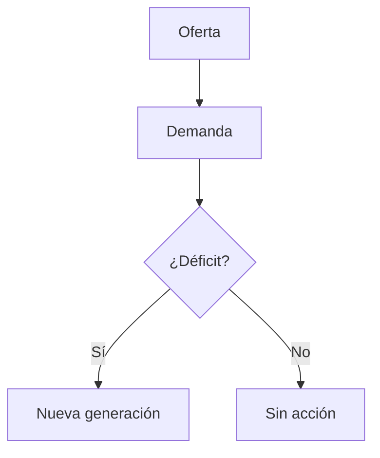
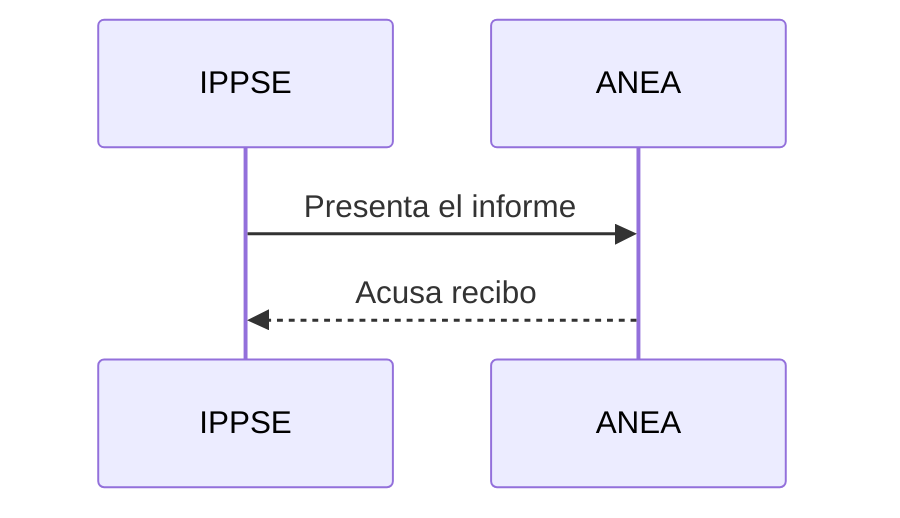

## Tablas

| Tecnología | Costo USD/MWh | Plazo de habilitación |
|------------|--------------:|----------------------:|
| Solar FV   | 45            | 3 años                 |
| Eólica     | 58            | 4 años                 |
| Nuclear SMR| 120           | 15 años                |

## Diagrama de flujo

## Diagrama de secuencia

## Fórmulas

La energía relativista es $E = mc^2$ y el rendimiento se calcula así:

$$
\eta = \frac{P_{salida}}{P_{entrada}} \times 100
$$

Una integral de bloque:

$$
\int_0^1 x^2 \, dx = \frac{1}{3}
$$

## Notas al pie

El factor de planta[^1] incide directamente en la energía firme[^2].

## Formato en línea

Esto está ~~tachado~~, esto es **negrita**, esto _cursiva_ y esto `código`.

Lista de tareas:

- [x] Revisar tablas
- [ ] Revisar diagramas

[^1]: Relación entre la energía generada y la que se generaría a potencia nominal todo el tiempo.
[^2]: Potencia que puede entregarse de forma sostenida en las horas de mayor demanda.
